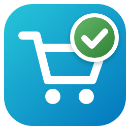
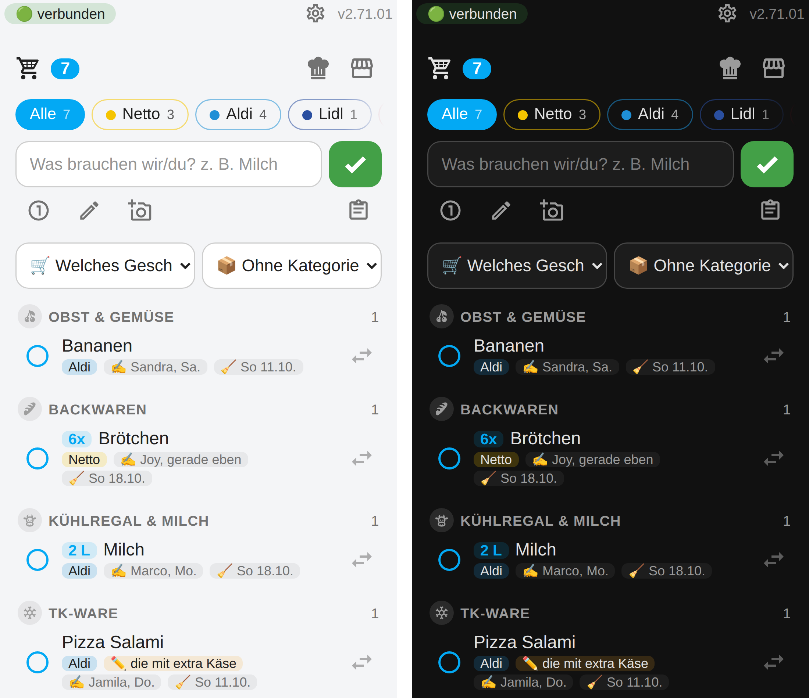
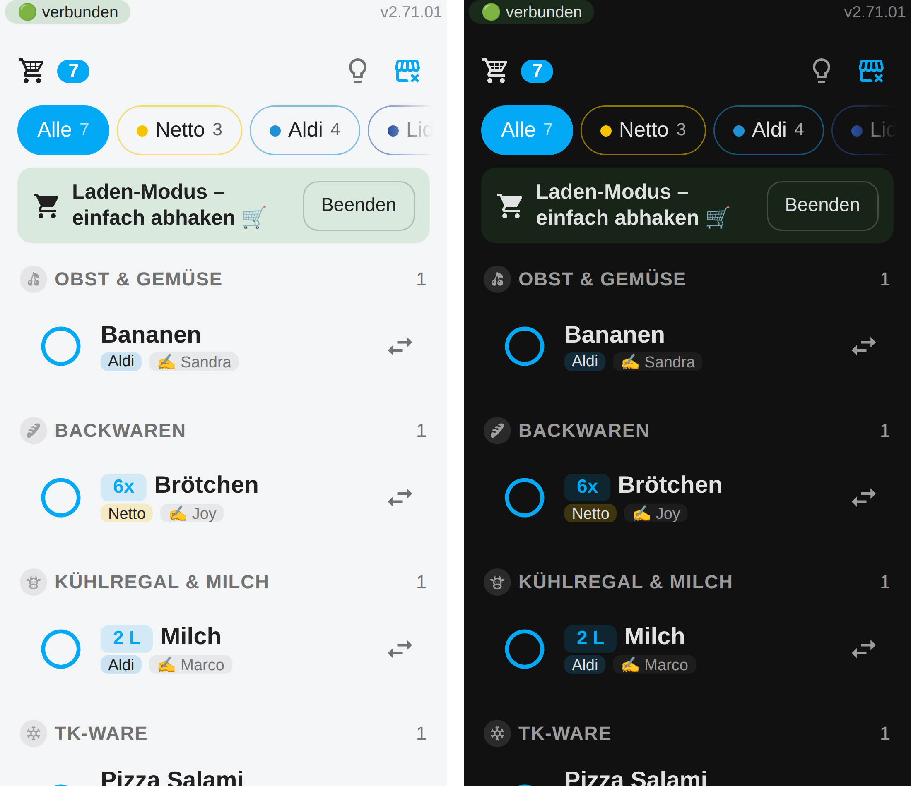

# 🛒 Einkaufsliste für Home Assistant

🇬🇧 **English?** → [README in English](README.en.md)

**Die Familien-Einkaufsliste direkt im Dashboard.** Mehrere Geschäfte, Kategorien, Rezepte und Live-Sync auf allen Handys. Hinter jedem Artikel steht, wer ihn eingetragen hat. Gekauftes wird abgehakt und bleibt als „schon mal gekauft“ stehen – beim nächsten Mal ist es mit einem Tipp wieder drauf.



<details><summary>🛒 Laden-Modus ansehen</summary>



</details>

---

## ✨ Was kann das Ding?

- 🏪 **Mehrere Geschäfte** mit eigenem Reiter – im Laden springt die Liste von selbst zum richtigen.
- 👨‍👩‍👧‍👦 **Für die ganze Familie**, live auf allen Handys, ohne Admin-Rechte.
- ⚡ **Schnell eintragen** mit Vorschlägen, Mengen („3 milch“), Fotos und Barcodes.
- 🍽️ **Rezepte** mit Koch-Modus, Essensplan und Zutaten per Tipp auf die Liste.
- 🛒 **Laden-Modus** mit großen Zeilen – und 📱 **Offline-App**, die auch ohne Netz geht.
- 🗣️ **Alexa**, 🥫 Grocy, 🏷️ Angebote, ⚠️ Rückruf-Warnung, 🤖 KI-Kochideen und vieles mehr.
- 🌍 Deutsch & Englisch, alles bleibt **lokal** in Home Assistant.

<details><summary>📋 Alle Funktionen im Detail</summary>

| Funktion | So klappt's |
|---|---|
| 🏪 **Mehrere Geschäfte** | Jedes Geschäft hat oben seinen Reiter. Bist du laut Standort in einem Laden, springt die Liste dorthin. |
| 🗂️ **Kategorien** | Obst & Gemüse, TK-Ware … Die Liste rät die Kategorie selbst („Joghurt“ → Kühlregal). |
| 👨‍👩‍👧‍👦 **Für die ganze Familie** | Jeder mit HA-Benutzer macht mit, ohne Admin-Rechte. Live auf allen Handys. |
| ♻️ **Nichts geht verloren** | Abgehaktes rutscht nach unten zu „Erledigt“. Kreis antippen = wieder drauf. |
| 🏷️ **Für wen & wer** | *Käse (für Oma)* – und klein darunter, wer es eingetragen hat. |
| ⚡ **Schnell eintragen** | „3 milch“ oder „500 g mehl“ – Menge und Name werden erkannt, eine Eingabe ist immer ein Produkt. Vorschläge übernehmen alles vom letzten Mal. Schon nach **1–2 Buchstaben** kommen auch Vorschläge aus einer eingebauten Liste mit ~1400 gängigen Produkten (mit Kategorie, nur deutsch). |
| 🍽️ **Rezepte** | Zutaten per Tipp auf die Liste, für x Personen umgerechnet. Mit Koch-Modus, Fotos, Teilen und Import (auch Links und US-Maße). **📅 Essensplan** (pro Person unter 👁️ Ansicht abschaltbar)**:** jedes Rezept lässt sich auf „💭 Wunsch“ oder „📅 Diese Woche“ stellen; oben stehen die geplanten, dazu „Alle Zutaten auf die Liste“ (zeigt jedes eingeplante Rezept nacheinander mit Personenzahl und Zutaten zum Abwählen). |
| 🔍 **Barcodes** | Scannen in der HA-App oder mit der Handykamera in der Offline-App: zu Hause eintragen, im Laden abhaken. |
| 🔁 **„War aus!“** | ⇄ am Artikel: nächstes Mal wieder hier oder gleich in ein anderes Geschäft. Die Liste merkt sich, was oft fehlt. |
| 🛒 **Laden-Modus** | Große Zeilen, nur abhaken – mit einer Hand am Wagen. Unten steht **„Gerade abgehakt“**: aus Versehen abgehakt? Auf ↩️ tippen, und es ist samt Notiz und Menge zurück. |
| 📱 **Offline-App** | Die komplette Karte als App fürs Handy, öffnet auch ohne Netz. Änderungen werden nachgeschickt. |
| ⏲️ **Gar-Zeiten** | Spickzettel nach Gerät: 🍲 Herd, 🔥 Backofen, 💨 Heißluftfritteuse. |
| 🧹 **Aufräumen** | Einmal pro Woche wird Altes **abgehakt**, gelöscht wird nichts. An/Aus, Tag und Uhrzeit direkt in der Karte (⚙️ → Aufräumen). |
| 👁️ **Listenansicht** | Selbst bestimmen, was beim Artikel steht (Menge, Notizen, wer, wann, Foto, Stern …) – Standard für alle in ⚙️, **pro Person** ganz unten mit „👁️ Ansicht“ (ohne PIN). Beides sind **Aufklapper** (Schriftgröße · Oben & beim Eintragen · Beim Artikel), immer nur einer ist offen. |
| 🟢 **Leiste oben** | Auf jeder Seite: verbunden / wartet / offline, 🔓 Sofort-Sperren (mit PIN) und die Version. |
| 🔒 **PIN** | Das Zahnrad (Einstellungen) nur mit PIN – die Liste bleibt für alle offen. |
| 📌 **Seitenleiste** | Auf Wunsch ein eigener Eintrag links in der Seitenleiste (die Liste auf der ganzen Seite, ohne eigenes Dashboard). Standardmäßig **aus**: Geräte & Dienste → Einkaufsliste → Konfigurieren → „In der Seitenleiste anzeigen“. |
| 📸 **Text aus Foto** | Einkaufszettel oder Kassenbon fotografieren, die Karte liest den Text direkt auf dem Gerät (Handschrift klappt nur mit Glück – Text vorher korrigierbar). Überschriften wie „Aldi:“ im Zettel ordnen Artikel dem Geschäft zu, beim Bon kannst du bei mehreren Beträgen den richtigen antippen. Dazu: 🩺 Gesundheits-Ampel (auch als Sensor `sensor.einkaufsliste_gesundheit`), 🐞 Fehler-Protokoll, 🧲 Produkte zusammenführen. |
| 🌍 **Deutsch & Englisch** | Die Karte spricht die Sprache von Home Assistant. |

Leere Eingabefelder zeigen ein Beispiel (bei der Menge passend zum Produkt, z. B. „2 L“), und die Anleitungen gibt es in Hell und Dunkel (wie die Karte). Dazu viele Kleinigkeiten: Fotos pro Produkt, Spitznamen („Tempos“ = Taschentücher), gelernte Tippfehler, Eigenmarken beim Scannen, Doppelt-Finder, Verlauf, Sicherung, Maskottchen 🛒😊 und mehr.

**🗣️ Mit Alexa:** „Alexa, setz Milch auf die Einkaufsliste“ – und die Milch steht auf *dieser* Liste (siehe ⚙️ Einstellungen → „Alexa & andere Listen“).

</details>

---

## 📦 Installation

1. **HACS** öffnen und nach **Einkaufsliste** suchen.
2. **Herunterladen**, danach **Home Assistant neu starten**.
3. **Einstellungen → Geräte & Dienste → Integration hinzufügen → Einkaufsliste** → Absenden, fertig. 🎉 (Aufräum-Tag und Uhrzeit stellst du später in der Karte ein: ⚙️ → Aufräumen.)
4. Dashboard → **Bearbeiten → Karte hinzufügen → Einkaufsliste**.

```yaml
type: custom:einkaufsliste-card
```

> 🙌 Eine Ressource musst du **nicht** von Hand eintragen, das macht die Integration selbst.
> Sieht die Karte nach einem Update komisch aus? In der App einmal nach unten ziehen oder im Browser Strg+F5.

<details><summary>Findet HACS die Einkaufsliste nicht? (als benutzerdefiniertes Repository)</summary>

In HACS oben rechts **⋮ → Benutzerdefinierte Repositories** öffnen, `https://github.com/misterm2310/einkaufslisten-card` eintragen, Typ **Integration**, **Hinzufügen**. Danach weiter mit Schritt 1.
</details>

<details><summary>Ohne HACS (von Hand)</summary>

Den Ordner `custom_components/einkaufsliste` nach `/config/custom_components/einkaufsliste` kopieren und Home Assistant neu starten.
</details>

---

## 👆 So wird's benutzt

<details><summary>Eintragen, abhaken, wischen, Laden-Modus, Öffnungszeiten, Filialen und Rezepte – <i>aufklappen</i></summary>

**Eintragen:** Name tippen, grüner Haken ✔. Die Knöpfe darunter: 🔢 Menge · ✏️ Eigene Notiz · 👤 Für wen · 📷 Foto (am Handy: 📷 Kamera · 🖼️ Galerie · 📋 Einfügen – die Kamera öffnet sich über https direkt in der Karte; in der HA-App über die lokale http-Adresse geht gleich die Galerie auf. Am PC: Fenster zum Reinziehen, **Strg + V** (z. B. Screenshot aus dem Prospekt) oder Auswählen) · ⭐ alle Favoriten auf die Liste (Produkt beim Bearbeiten mit „⭐ Favorit“ markieren; was schon draufsteht, kommt nicht doppelt) · 🧽 alles leeren. Geschäft und Kategorie sind meist schon richtig ausgewählt. Ein Geschäft fehlt? In der Auswahl **„➕ Neues Geschäft …“** – nur den Namen tippen, den Rest später in ⚙️. 🎨 Bekannte Ketten (Aldi, Lidl, Rewe, Edeka, dm, Rossmann …) bekommen dabei gleich ihre Logo-Farbe; in ⚙️ → Geschäfte geht das schon beim Tippen, und eine selbst gewählte Farbe bleibt.

**In der Liste:**
- ⭕ **Kreis** = abhaken. Unten bei „Erledigt“ nochmal = wieder drauf.
- 👆 **Wischen** (am Handy): Zeile **nach links** = abhaken ✔, erledigte Zeile **nach rechts** = wieder auf die Liste ↩.
- ↩️ **Versehentlich abgehakt?** Unten steht 3 Sekunden „Rückgängig“ (nur bei dem, der selbst abgehakt hat). Nach „Mehrere scannen“ / „Scannen & abhaken“ steht 5 Sekunden „Rückgängig“ für den zuletzt gescannten Artikel.
- ⇄ = war aus (bleibt offen mit „war aus“ oder wandert in ein anderes Geschäft) oder **❌ War nicht da**: brauchst du nicht mehr – der Artikel bleibt 2 Tage grau mit „❌ war nicht da“ für alle sichtbar und wird dann ohne Kauf abgehakt (zählt nicht als gekauft). Wer den Knopf nicht will, schaltet ihn unter ⚙️ → Listenansicht aus.
- 🤷 **„Egal wo“** = Artikel ohne festes Geschäft. Die stehen in **jedem** Geschäfts-Reiter mit drin (mit Schildchen „🤷 Egal wo“) – egal, wo du gerade bist. Abhaken = überall weg. Gibt es so ein Produkt bei einem Geschäft nicht (z. B. Cola bei dm), schaltest du in den Einstellungen dieses Geschäfts **„Egal wo“-Artikel hier nicht zeigen** ein. Mit ⇄ in ein Geschäft verschieben = zieht einfach um, ohne Rest bei „Erledigt“. Andersrum geht's auch: ⇄ → **🤷 Egal wo**. Wird so ein Artikel im Reiter eines Geschäfts abgehakt, gehört er ab dann dorthin (dort unter „Erledigt“, bei den anderen weg) – und kommt beim nächsten Mal wieder dort auf die Liste.
- **Lange drücken** = Menü: bearbeiten, verschieben, Menge, Kategorie, Foto, Barcode, Infos.
- **Auf die Menge tippen** = [−] 2x [＋]. In der Zeile **wischen** (überall von − bis ＋, ‹ ›): nach rechts = mehr, nach links = weniger, jeder Schritt und jeder Tipp auf − / ＋ vibriert kurz (nicht am iPhone, das erlaubt Apple nicht), Loslassen speichert.
- ✨ = neu seit deinem letzten Blick, die rote Zahl am Reiter zeigt, wie viel Neues dort steht.
- Oben links bringt dich der **Einkaufswagen** von überall (Rezepte, Einstellungen …) zurück auf die Einkaufsliste.
- Ganz unten unter der Liste öffnet **📖 Anleitung** eine Anleitung für die ganze Familie – samt App-Link zum Kopieren.

**Im Laden:** Das **🏪 Geschäft** oben rechts schaltet den **Laden-Modus** ein. Kein Netz? Einfach weiter abhaken, oben in der Leiste steht dann ⏳ orange und alles wird nachgeschickt. Mit dem **🧮-Rechner** (links neben 💳, nur im Laden-Modus) rechnest du schnell nach: + − × ÷ und %, die Tasten vibrieren kurz, ← bringt dich zurück an die Stelle in der Liste. Öffnest du die Liste mitten im Einkauf neu (in den letzten 30 Minuten etwas abgehakt), springt sie im Laden-Modus von selbst zum **ersten offenen Artikel**. Unter der Liste liest **🔊 Vorlesen** die offenen Artikel vor. Die **Vibration** stellst du unter 👁️ Ansicht ein (Aus/Schwach/Normal/Stark). **🕒 Öffnungszeiten** trägst du in ⚙️ → Geschäfte ein (optional, auch mehrere Zeitfenster am Tag, auf andere Tage übertragbar, mit „＋ Filiale“ eigene Zeiten für jede Filiale, z. B. 3× K&K, mit „🌐 Zeiten aus OpenStreetMap“ auf Knopfdruck aus dem Netz holen (Home Assistant fragt, die Zeiten stammen von Freiwilligen) und mit „🎌 An Feiertagen zu“ nach deinem Bundesland): hat das Geschäft zu, wird sein Reiter grau, den Namen gedrückt halten zeigt die Zeiten. **🗞️ Prospekt-Link** pro Geschäft (⚙️ → Geschäfte): Namen gedrückt halten, dann „Prospekt öffnen“. Es wird nur die Adresse gespeichert, die Karte ruft nie selbst etwas ab, und die Seite erfährt nicht, woher du kommst. **ℹ️ Steckbrief** pro Geschäft (⚙️ → Geschäfte): 📍 Adresse, 📞 Telefon, 🌐 Webseite und 💡 eure eigenen Tipps („Parkplatz hinten ist frei“). Gibt es dazu etwas, steht im Fenster mit den Öffnungszeiten (Reiter gedrückt halten) neben dem Namen ein **ℹ️** – antippen klappt alles auf, nochmal antippen wieder zu: Adresse öffnet die Karte, Telefon ruft an. Holst du die Zeiten bei 🌐 OpenStreetMap, kommen Adresse, Telefon und Webseite meist gleich mit (nur in leere Felder, auch für jede Filiale – die bekommt dann ihr eigenes ℹ️). **🏬 Filialen:** Hat ein Geschäft Filialen, steht unter ⚙️ → Geschäfte → „🏬 Filialen ändern“ pro Filiale eine kurze Zeile (Name, Adresse, ob Zeiten da sind). **✏️ Bearbeiten** öffnet ein eigenes Fenster wie bei den Rezepten: Name, 📍 Adresse, 📞 Telefon, 💡 Tipps und die Öffnungszeiten der Filiale. Erst **💾 Speichern** schreibt alles weg, **Abbrechen** lässt alles, wie es war, **🗑️ Löschen** will zweimal angetippt werden. „＋ Filiale“ öffnet dasselbe Fenster leer. Die 🌐 Webseite bleibt beim Geschäft, sie gilt für alle Filialen. Ein Geschäft ohne Filialen bleibt wie bisher. Mit dem **💡-Icon** (zwischen 💳 und 🏪) bleibt der Bildschirm im Laden-Modus an – es geht beim Verlassen von selbst aus. **In der HA-App** klappt das nur mit deren Einstellung *Einstellungen → Companion App → „Keep screen On“*. Im Laden-Modus steht unten nur noch **🔊 Vorlesen** (ohne „Nächstes Aufräumen“ und ohne die anderen Knöpfe). Beim Tippen steht der genau getippte Name zuerst („Birne“ vor „Birnen“). Beim Eintragen zeigt der Mengen-Knopf die gewählte Zahl in Blau statt „123“. „Hier gibt es Fotos“ zeigt ein Bild-Symbol (bei mehreren gestapelte Bilder); im Laden-Modus steht es rechts, wo sonst das Angebotszeichen war; auch im Katalog zeigt „Fotos“ dieses Symbol.

**Rezepte:** Anlegen in ⚙️ → Rezepte (Zutaten genau wie auf der Liste eintragen, oder eine Zutaten-Liste bzw. einen Rezept-Link einfügen). Die **Kochmütze** oben: **Auf die Liste** → anhaken, was fehlt → fertig. Dazu 👥 Personen oder 🍕 Bleche umrechnen, **🔥 Kochen** (Schritt für Schritt), **Teilen** (z. B. WhatsApp) und **⏲️ Gar-Zeiten**. **🔗 Original öffnen:** beim Import per Link merkt sich das Rezept die Quelle. Der Koch-Modus merkt sich pro Rezept den Schritt und fragt, ob du dort weitermachen willst. **➕ Mehrere Rezepte gleichzeitig:** im Koch-Modus oben ➕ antippen und ein zweites Rezept wählen – oben erscheinen Reiter zum Hin- und Herspringen, die Timer laufen für alle weiter, und solange alle noch bei der Personen-Auswahl stehen, sagt ein 💡 Tipp, womit du anfangen solltest (das mit der längsten Zeit aus den Schritten). Der Geräte-Kasten (z. B. Backofen) erscheint erst nach „Los geht’s“. **📝 Notiz nach dem Kochen:** nach dem letzten „Fertig“ fragt die Liste „Notiz fürs nächste Mal?“ (z. B. „weniger Salz“). Die Notiz steht sofort beim nächsten Kochen gelb oben und in der Rezeptliste. Zusätzlich steht sie in ⚙️ → Rezepte → **Wartet auf OK**: ✏️ öffnet das Rezept zum Anpassen, 🗑️ (oder ✕ beim Kochen) löscht die Notiz überall. **💳 Kundenkarte am Geschäft:** beim Bearbeiten einer Karte ein Geschäft wählen – im Laden-Modus dort steht sie in „Meine Karten“ ganz oben (📍), die anderen bleiben darunter. **🍟 Fritteuse:** Hat ein Schritt „Heißluftfritteuse“ mit Programm, Temperatur und Minuten und ist Airfryer Control installiert, schickt der Knopf im Koch-Modus (für alle, braucht eine aktuelle Airfryer Control) die Werte an die Fritteuse – gestartet wird am Gerät. **▥ Scan:** steht ein gescannter Artikel schon auf der Liste, sagt die Liste „steht schon drauf“. Abgehakte Rezept-Zutaten verschwinden ganz. Die Knöpfe sind nur Icons; den Text zeigt ⚙️ → Extras → **Beschriftungen** oder langes Drücken.

</details>

---

## 🔍 Barcode scannen

<details><summary>Zu Hause scannen = eintragen, im Laden scannen = abhaken – <i>aufklappen</i></summary>

Der ▥-Knopf oben weiß, wo du bist:
- 🏠 **Zu Hause:** Packung scannen → Name, Marke und Kategorie sind ausgefüllt → ✔. Mit **„📦 Mehrere scannen“** kommt jede Packung sofort auf die Liste. Unbekannte landen als „❓ Unbekannt“ drauf – einmal umbenennen, dann kennt die Liste den Barcode.
- ▥ **Barcode nachträglich zuordnen** (lange drücken → Barcode): Heißt das Produkt in der Datenbank anders als bei dir, kannst du einzeln wählen, ob Name und/oder Notiz übernommen werden.
- 🛒 **Im Laden** (Geschäft mit 📍 Zone): Jede gescannte Packung wird auf der Liste abgehakt.

**Wo geht das?**
- In der **Home-Assistant-App** (Android/iPhone) mit deren Scanner – klappt auch über `http://`.
- In der **Offline-App** mit der Handykamera. Beim ersten Mal fragt das Handy, ob die Seite die Kamera nutzen darf. Ohne Netz erkennt sie nur Barcodes, die die Liste schon kennt; eingetragen und abgehakt wird trotzdem (wird nachgeschickt).
- Am PC-Browser gibt's keinen Scanner.

Die Produktnamen kommen aus **Open Food Facts**, **Open Beauty Facts** und **Open Products Facts** (dafür braucht Home Assistant Internet). Eigenmarken wie Milsani, ja! oder Balea landen gleich beim richtigen Geschäft; eigene Marken trägst du in ⚙️ → Geschäfte ein.

</details>

---

## 📱 Offline-App

<details><summary>Die ganze Karte als App aufs Handy – öffnet auch ohne Netz – <i>aufklappen</i></summary>

Die **komplette Karte** als eigene App auf dem Startbildschirm – mit Rezepten, Koch-Modus, Gar-Zeiten, Einstellungen und Kamera-Scanner. Sie öffnet auch **ohne Netz** mit dem letzten Stand.

1. Die Adresse kopieren: in **⚙️ → App & Info → Offline-App** oder in der **Anleitung** (Knopf „📖 Anleitung“ ganz unten) – so kommen auch alle ohne Zahnrad dran.
2. Im Handy-**Browser** einfügen (Chrome oder Safari, nicht die HA-App).
3. Mit dem eigenen Home-Assistant-Benutzer anmelden.
4. Browser-Menü → **„Zum Startbildschirm hinzufügen“**.

**↩️ Zurück-Taste:** geht in der App Schritt für Schritt zurück (Fenster zu, Einstellungen eine Stufe hoch, Laden-Modus aus). Erst auf der normalen Liste geht die App zu. Das gilt auch in der **HA-Karte im Dashboard**: Zurück schließt ein Fenster nach dem anderen, bevor die Seite verlassen wird.

**📱 Schnellmenü (Android):** Lange aufs App-Symbol drücken → ✍️ Eintragen · 🛍️ Laden-Modus · 📷 Scannen – die App geht gleich an der richtigen Stelle auf. (Auf dem iPhone gibt es das für Web-Apps nicht.)

**Nur mit Netz:** neue Barcodes nachschlagen, Produkt-Infos, Rezept-Links, neue Fotos, Sicherung.

**🔄 Nachschicken bei geschlossener App:** Unter **Android mit Chrome** schickt die App gemerkte Änderungen auch dann nach, wenn sie zu ist – Android weckt sie kurz auf, sobald wieder Netz da ist (wann genau, entscheidet Android; bei strengem Akkusparen kann es dauern). Auf dem **iPhone** geht das nicht, dort wird beim nächsten Öffnen nachgeschickt. Jede App hat ihre eigene Warteschlange: Was in der Offline-App gemerkt ist, schickt auch nur die Offline-App nach.

**🔑 Anmelden:** Die App hat ein eigenes kleines Anmeldefenster (Benutzername, Passwort und – falls eingeschaltet – der 2-Faktor-Code). Es benutzt dieselbe offizielle Anmeldung von Home Assistant wie die normale Anmeldeseite: dieselben Benutzer, dieselben Rechte, dieselbe Sperre nach falschen Versuchen. Wer eine besondere Anmeldung nutzt (z. B. „vertrauenswürdige Netzwerke“), tippt unten auf **„Mit der Home-Assistant-Seite anmelden“**.

**🔌 Hinter einem Reverse Proxy (Caddy, nginx …):** Die App braucht von außen nur diese drei Bereiche: `/einkaufsliste/*`, `/auth/*` und `/api/*` (genau genommen reicht bei `/api/` die Live-Verbindung `/api/websocket`, plus `/api/einkaufsliste/pdf/*` für die PDF in der HA-App). Ehrlich gesagt: Mit `/auth/` und `/api/websocket` ist die normale Home-Assistant-Anmeldung von außen erreichbar. Wer sich anmeldet, darf alles, was sein Benutzer darf – nicht nur die Einkaufsliste. Am besten einen eigenen Benutzer **ohne Admin-Rechte** mit starkem Passwort nehmen und `ip_ban_enabled` anlassen.

Gut zu wissen: Es braucht eine **https**-Adresse (z. B. Nabu Casa). Ändern zwei Leute gleichzeitig dasselbe, gewinnt die letzte Änderung. iPhones löschen den Offline-Speicher manchmal, wenn die App wochenlang nicht geöffnet wurde – dann einmal mit Netz öffnen.

</details>

---

## ⚙️ Die Einstellungen (Zahnrad)

<details><summary>Geschäfte, Kategorien, Rezepte, Katalog, Aufräumen, Sicherheit und alle Extras – <i>aufklappen</i></summary>

Die Einstellungen sind eine **Liste mit Gruppen** – **📋 Meine Liste · 🎛️ Extras · 💾 Daten · 🩺 Gesundheit · 👁️ Ansicht · 📱 App & Info** – und nur **eine Ebene tief**. Fenster (PIN, Foto, Barcode, Scanner, Karte ändern, Teilen …) öffnen als **Seite in der Karte** mit ← oben links; nur der Koch-Modus ist Vollbild. Auf solchen Seiten stehen unten keine Knöpfe (Ansicht, Anleitung, Abmelden). Wer die Einstellungen verlässt, findet beim nächsten Mal alle Gruppen zugeklappt. Ganz unten auf der ersten Seite steht **📖 Anleitung**. Ein **Suchfeld** ganz oben findet Zeilen nach Name oder Thema („Foto“, „Mail“, „Sicherung“, „Sensor“). Jede Gruppe ist ein **Kasten** mit kurzer Vorschau, was drin ist, und jede Zeile hat ein **buntes Icon** – so wie das Einstellungs-Menü am Handy. Die Gruppen sind erst **zugeklappt**: antippen öffnet sie, die vorherige geht dabei zu (die Suche klappt passende von selbst auf). Einfache An/Aus-Sachen (🛒😊 Maskottchen, 💳 Kundenkarten, 🧾 Einkaufs-Protokoll, 📍 Laden-Modus automatisch, 🏷️ Beschriftungen) haben einen **Schalter direkt in der Zeile**; die Zeile selbst öffnet die Erklärung mit demselben Schalter oben. Zurück geht es mit dem runden **←** oben. Unten gibt es den Knopf **📖 Anleitung Einstellungen**; die Anleitung fürs Einkaufen und die Rezepte steht davon getrennt vorne (Einkaufswagen oder Knopf „Anleitung“).

| Zeile | Was drin ist |
|---|---|
| 🏪 **Geschäfte** | Eine Liste, ein Geschäft pro Zeile. **⌃ ⌄** direkt in der Liste = Reihenfolge der Reiter. Antippen = Name, Farbe, Icon, 📍 Zonen (mehrere, z. B. für mehrere Filialen), 🔨 **Nicht unter „Alle“ zeigen** (z. B. Baumarkt: die Sachen stehen nur im eigenen Reiter und machen die tägliche Liste nicht länger; zusammen mit „Aufräumen → Geschäfte ausnehmen“ bleiben sie offen, bis sich die Fahrt lohnt), 🏷️ Eigenmarken und 🗺️ **Kategorien-Folge** (Standard: wie überall – oder eigene, so wie du durch den Laden läufst). Ohne eigenes Icon nimmt die Liste das Icon der Zone (falls sie eins hat), sonst 🛒. |
| 🗂️ **Kategorien** · 👥 **Personen** | Wie bei den Geschäften: erst die Liste (sortieren mit ⌃⌄, neu anlegen unten), dann antippen = umbenennen, Farbe, Icon (einfach „hund“ tippen, ohne „mdi:“), löschen. Die Felder stehen untereinander. |
| 👁️ **Listenansicht** (unter 👁️ Ansicht) | Ganz oben **🏷️ Beschriftungen** (Text unter den Icons, nur für dich; sonst gilt ⚙️ → Ansicht → Beschriftungen), dann **Schriftgröße** und Häkchen setzen oder wegnehmen: Menge, Notizen, Für wen, wer eingetragen/abgehakt hat, Datum, 🧹-Tag, Geschäft, Rezept, Foto, ⭐, ▥, Angebote, „war aus“, ❌ „War nicht da“-Knopf, ⇄-Knopf, ✨ und Kategorie-Farbe. Hier in ⚙️ der **Standard für alle**. Neu: **Schriftgröße** (Kleiner / Standard / Größer) und **Ausblenden** der Eingabefelder (Was brauch ich, Geschäfte, Kategorien, Icon-Leiste) sowie der Geschäfte-Leiste oben – für ruhige Listen am Tablet. Seine **eigene Ansicht** stellt jeder ganz unten mit **„👁️ Ansicht“** (neben „📖 Anleitung“) ein – ohne Zahnrad und PIN (gilt für deinen HA-Benutzer auf allen Geräten). |
| 👨‍🍳 **Rezepte** | Zwei Reiter: **Rezepte** (neu, bearbeiten, löschen) und **Rezept-Gruppen** (Liste wie bei den Kategorien: Gruppe antippen = Name, Farbe, Icon ändern). Die Zubereitung hat **eine Zeile pro Schritt** (mit Foto); die Schritte lassen sich am **⠿** ziehen (oder mit ↑ ↓) **verschieben** – die Fotos wandern mit. Darüber der Kasten **📅 Wochenplan**: Schalter „Eingeplante Rezepte automatisch zurücksetzen“ und der Wochentag (03:30 Uhr, Standard Montag). Dann gehen alle „📅 Diese Woche“-Rezepte zurück auf „nichts“, 💭 Wünsche bleiben stehen. Gilt für alle. · **👥 Personenzahl in der Kochansicht:** bei den Zutaten (🥕) mit − und + umstellen, die Mengen werden mitgerechnet (Start: die zuletzt beim „Auf die Liste“ gewählte Zahl). · **👨‍🍳 Kochansicht:** fragt vorher „Für wie viele Personen?“, zeigt links die Schritte und rechts die Zutaten (umgerechnet), lange Texte laufen von selbst (Wischen hält sie an), merkt sich Schritt und Personenzahl nach dem Neuladen. **⏲️ Kochtimer:** läuft in Home Assistant weiter, auch wenn du die App wechselst; oben in der Kochansicht öffnet **⏱️** das **Timer-Fenster** (Zeit aus dem Schritt-Text als Vorgabe, Schnellwahl, eigener Name optional, Liste aller Timer); Ereignis `einkaufsliste_timer_fertig` und Sensor `sensor.einkaufsliste_kochtimer` für eigene Automationen (z. B. Alexa-Ansage). Die Timer-Chips sehen alle; **Piepen, Vibration und Meldung bekommt nur, wer den Timer gestartet hat.** |
| 📦 **Produkte/Katalog** | Alles, was die Liste kennt: umbenennen, Kategorie, Standard-Geschäft, Spitznamen, Fotos, Barcodes, gelernte Tippfehler, ganz löschen. Die Liste zeigt zuerst 80 Produkte, **➕ 10 weitere** und **Alle anzeigen** holen den Rest (gilt auch für „Einkaufsliste Produkte löschen“). Dazu „Neu gescannt“ zum Prüfen, 🔽 Filter (ohne Kategorie, ohne Foto, pro Geschäft …) und **➕** (neues Produkt) und **▥** (per Barcode: scannen, Namen bestätigen). Der Filter **🗓️ Seit 3 Monaten nicht gekauft** (zuletzt abgehakt, sonst zuletzt eingetragen; nichts, was auf der Liste oder in einem Rezept steht) zeigt Produkte zum Aufräumen – einzeln oder **alle auf einmal löschen**. Am PC: Klick markiert, ↑↓ blättert, Doppelklick/Enter bearbeitet – genauso in **Einkaufsliste**, **Rezepten** und **Gelöscht** (Leertaste hakt ab, Esc geht zurück, die ⚙️-PIN bestätigt Enter). · **▥ Barcode nachtragen** (im Produkt: Nummer tippen – Enter bestätigt – oder scannen; danach schaut die Liste in der Datenbank nach) · **🗄️ Daten neu laden** (Produkt mit Barcode: zeigt Name, Notiz, Nutri-Score und Allergene aus der Datenbank neben deinen Daten; du hakst einzeln Name, Notiz und/oder Foto an) · **✏️ Eigene Notiz** (das einzige Notiz-Feld zum Selbertippen, gilt auch bei Rezept-Zutaten und Rezept-Artikeln auf der Liste, bleibt beim Produkt, wird von der Datenbank nie überschrieben; die 📝 Notiz kommt nur noch aus dem Barcode; alte, selbst getippte Notizen zeigt die Liste automatisch als ✏️; im Katalog steht hinter dem Namen die Barcode-Notiz, sonst die ✏️) · **🔄 Alles neu holen** (Wolken-Symbol bei „Alle Produkte“: du wählst Foto (vorausgewählt), Name und/oder Notiz, dann geht es nacheinander durch alle Produkte mit Barcode; eigene Fotos und ✏️ Eigene Notiz bleiben; kleine Pausen, Wiederholung bei Fehlern, alle Barcodes werden probiert; am Ende ein Bericht pro Produkt: angepasst, schon gleich, Datenbank kennt nichts/nicht erreichbar, kein Foto) · **🔎 Suche** findet nach Name, Notizen, Spitznamen, Barcode-Nummer, Kategorie, Geschäft und gelernten Tippfehlern · **🏷️ Spitznamen** lassen sich auch beim Bearbeiten eines Artikels eintragen (lange drücken → Bearbeiten, mehrere mit Komma) |
| 💾🩺 **Daten & Gesundheit** | **Alles ok?** (findet kaputte Einträge; bei jedem Fund 🔧 Beheben, ✏️ Selbst ändern und – wo nötig – eine Auswahl, oder anhaken und alles auf einmal reparieren) · **Import & Sicherung** (Listen aus anderen Apps – einmal oder 🔁 automatisch – in **Aufklappern**, Sicherung als .zip; Datei-Import und Sicherung nur Admins) · **Verlauf** (wer hat wann was gemacht, „📈 Oft nicht bekommen“, per ✖ ausblendbar) · **Aufräumen** (an/aus, Tag, Uhrzeit, Mindestalter) · **📊 Ressourcen** (wie viel Platz Daten und Fotos brauchen, dazu die 📊 Last-Anzeige) |
| 🎛️📱 **Extras, App & Info** | **🏷️ Angebote** (Extras, siehe unten) · **Offline-App** (deine Adresse mit „Kopieren“) · **Maskottchen** 🛒😊 (Schalter gilt für alle; gähnt morgens 6–9 Uhr, schläft abends ab 21 Uhr, trägt den Kürbis von 2 Wochen vor bis 1 Woche nach Halloween) · **📍 Laden-Modus automatisch** (Schalter gilt für alle Geräte, auch in der Offline-App; der Standort bleibt bei jedem selbst: er geht nur an, wenn *dein* Handy in die Zone kommt) · **💳 Kundenkarten** (Schalter gilt für alle; Payback & Co. einscannen (QR, **Aztec** oder Strichcode), eintippen oder **fotografieren**, „für alle“ oder „nur ich“, groß anzeigen, auch im Laden-Modus; das Format kommt automatisch vom Scanner; ein Foto liegt nur auf deinem Home Assistant und hilft nicht bei „Rollcodes“, die ständig wechseln) · **🧾 Einkaufs-Protokoll** (Schalter gilt für alle, siehe unten) · **Schutz** (PIN 4–8 Ziffern fürs Zahnrad; vergessen? Geräte & Dienste → Einkaufsliste → Konfigurieren → „PIN zurücksetzen“, nur Admins – ehrlich gesagt: Schutz vor Verstellen, kein Tresor – Details im Kasten „🔐 Ehrlich zur Sicherheit“ unten). Solange das Zahnrad offen ist, steht in der Leiste ganz oben neben der Versionsnummer ein 🔓 – antippen sperrt sofort; in der letzten Minute vor der nächsten PIN-Abfrage blinkt es rot. Die Leiste zeigt außerdem einen **Gruß nach Uhrzeit** mit deinem Vornamen („☀️ Guten Morgen, Marco“); ist er zu lang für den Platz, läuft er als Laufschrift; unter 👁️ Ansicht schaltest du ihn für dich ab · **Hell / Dunkel** (unter 👁️ Ansicht, nur in der Offline-App: automatisch, hell oder dunkel) · **🛡️ Datenschutz** (was bleibt im Haus, was geht ins Internet; Admins schalten „Datenschutz an“ für alle Geräte) · **🏷️ Beschriftungen** (kurzer Text unter den Icons, Schalter in ⚙️ → Ansicht, gilt für alle; auch ohne Schalter zeigt **längeres Drücken** auf ein Icon kurz seinen Namen) |
| 🆕 **Was ist neu** | Was sich in der aktuellen Version geändert hat. Steht auch in der Anleitung. In einer **Beta-Version** steht oben zusätzlich ein Kasten „🧪 Du bist in der Beta …“ mit den Neuerungen dieser Beta. |
| 🙏 **Credits** | Version, wer's gemacht hat, Links zu GitHub und „Fehler melden“. Steht auch in der Anleitung. |

<details><summary><b>🔐 Ehrlich zur Sicherheit</b></summary>

- **Die PIN schützt nur die Oberfläche.** Sie hält Kinder und Versehen vom Zahnrad fern. Auf dem Server wird sie für Nicht-Admins **nicht** durchgesetzt: Wer einen Home-Assistant-Benutzer hat und die Schnittstelle (API) selbst anspricht, kommt auch ohne PIN an die Einstellungen. Falsch geratene PINs werden gebremst: **nach 5 Fehlversuchen 60 Sekunden Sperre**. Ein Tresor ist das trotzdem nicht.
- **Der E-Mail-Import vertraut der Absender-Adresse.** Der „Von“-Eintrag einer Mail wird nicht geprüft und lässt sich fälschen. Nimm deshalb ein **eigenes Postfach**, dessen Adresse niemand kennt.
- **🔒 Datenschutz** (⚙️ → App & Info → Datenschutz, nur Admins): keine Kamera, keine Fotos, kein Barcode-Scanner, kein KI-Kochen – es gehen also keine Fotos und keine KI-Anfragen raus. Auch das Barcode-Nachschlagen bei Open Food Facts, die 🏷️ Angebote, die ⚠️ Rückruf-Warnung und das Auffrischen von Produktdaten sind gesperrt (die Sperre gilt auch auf dem Server, nicht nur in der Karte). Nur der **Rezept-Import aus einem Link** ist davon **nicht** gesperrt – er läuft nur, wenn du ihn selbst startest. Was genau wohin geht, steht in ⚙️ → Datenschutz.

</details>

<details><summary><b>🧹 Aufräumen, einfach erklärt</b></summary>

Am Aufräum-Tag wird alles **abgehakt**, was mindestens 7 Tage (einstellbar) offen ist. Beispiel Sonntag: Am Dienstag eingetragen → am ersten Sonntag erst 5 Tage alt, bleibt → am zweiten Sonntag abgehakt. Unter jedem Artikel steht mit 🧹, wann es so weit ist. Gelöscht wird nichts. **An/Aus**, Tag, Uhrzeit und Mindestalter: in der Karte unter **⚙️ → Aufräumen** (gilt für alle). Ist es aus, verschwindet auch das 🧹-Datum unter den Artikeln. **🏬 Geschäfte ausnehmen:** Im Aufklapper „Automatisch“ lassen sich einzelne Geschäfte abschalten – ihre Artikel bleiben beim Aufräumen offen (kein 🧹-Datum); „Alles abhaken“ von Hand nimmt sie trotzdem mit. Die Seite besteht aus **Aufklappern** (Automatisch · Von Hand · Liste löschen · Alles löschen · Werkseinstellungen), immer nur einer ist offen.

**🧽 Liste löschen (nur Admins):** Unter ⚙️ → Aufräumen ein Geschäft (oder „Alle Geschäfte“) wählen, dann **„Erledigte löschen“** (nur Abgehaktes) oder **„Liste leeren“** (offen und erledigt – gut am Sonntag für die neue Woche). Vorher kommt eine Frage mit der Anzahl. Der **Katalog bleibt**: Produkte erscheinen beim Tippen weiter als Vorschlag, Fotos, Barcodes, Notizen und Favoriten bleiben. Nicht rückgängig.

**📊 Last-Anzeige:** ⚙️ → „Ressourcen“ zeigt unten „📊 Last“ mit Änderungen pro Minute, gesendeten Paketen und der Größe eines Pakets (siehe auch die Attribute von `sensor.einkaufsliste_gesundheit`).

**⚡ Weniger Last:** Viele schnelle Änderungen (z. B. mehrere Artikel nacheinander abhaken) werden jetzt zu **einem** Paket an die Karten und Apps gebündelt (max. alle 0,3 Sekunden), statt bei jeder Änderung die komplette Liste neu zu senden. Bei Last-Problemen hilft die Diagnose: Der Gesundheits-Sensor zeigt in den Attributen `aenderungen_gesamt`, `aenderungen_pro_minute`, `pakete_an_karten_gesamt` und `laufzeit_minuten`. Wenn `aenderungen_pro_minute` dauerhaft hoch ist, ändert sich ständig etwas – bitte als Issue melden.

**🗂️ Eigene Kategorien pro Geschäft:** Auf der Seite eines Geschäfts (⚙️ → Geschäfte) wählst du „Alle Kategorien wie überall“ oder „Eigene Kategorien“. Bei „Eigene“ hakst du an, welche Kategorien es in diesem Geschäft gibt, und kannst eine neue nur dafür anlegen. Die Liste dieses Reiters und das Kategorie-Ändern zeigen dann nur diese; Artikel aus einer abgewählten Kategorie stehen dort unter „Ohne Kategorie“ (die Kategorie des Artikels bleibt unverändert). Zusammen mit der eigenen Kategorien-Folge nutzbar.

**💣 Werkseinstellungen (nur Admins):** Ganz unten unter ⚙️ → Aufräumen setzt **„Werkseinstellungen – alles löschen“** wirklich alles zurück wie bei einer frischen Installation: Liste, Katalog, Fotos, Geschäfte, Kategorien, Personen, Rezepte, Kundenkarten, Grocy-/To-do-Verbindungen und alle Schalter. Nur die PIN bleibt. Zwei Sicherheitsfragen, **nicht rückgängig**.

**❓ Neu anfangen nach Entfernen der Integration:** Home Assistant löscht beim Entfernen einer Integration **keine Daten** – deshalb ist nach „entfernen, neu starten, neu installieren“ alles noch da (auch aus Grocy importierte Produkte). Zwei Wege: (1) vor dem Entfernen den Knopf **Werkseinstellungen** benutzen, oder (2) nach dem Entfernen die Datei `.storage/einkaufsliste.data` und den Ordner `einkaufsliste_fotos` im Konfigurationsordner löschen (Home Assistant vorher stoppen bzw. neu starten).

**🧹 Alles löschen (nur Admins):** Unter ⚙️ → Aufräumen löscht **„Katalog & Liste komplett löschen“** die Einkaufsliste und den ganzen Katalog mit allen Fotos, Barcodes, Spitznamen, Eigenen Notizen, Favoriten und gelernten Tippfehlern. Zwei Sicherheitsfragen, **nicht rückgängig** – vorher eine Sicherung machen. Geschäfte, Kategorien, Personen, Rezepte, Kundenkarten und Einstellungen bleiben.

</details>

<details><summary><b>📍 Nächstes Geschäft zuerst</b></summary>

Für jedes Geschäft eine **Zone** anlegen (Einstellungen → Bereiche, Beschriftungen & Zonen → Zonen) und sie in ⚙️ → Geschäfte → Geschäft antippen → 📍 auswählen. Mehrere Filialen? Einfach mehrere Zonen beim selben Geschäft wählen. Wer seinen Standort über die Companion-App sendet, landet im Laden automatisch im richtigen Reiter. Ist **⚙️ → Extras → Laden-Modus automatisch** an, geht der Laden-Modus im Geschäft von selbst an und beim Verlassen wieder aus (auch nach einem Neuladen der App). Der Laden-Modus sperrt dabei die Bildschirmdrehung wie beim Start (Hoch- oder Querformat), soweit Handy und Browser das erlauben (meist Vollbild oder installierte App, auf dem iPhone nicht).

</details>

<details><summary><b>🗣️ Alexa & andere Listen</b></summary>

Die Einkaufsliste kann eine andere To-do-Liste aus Home Assistant **automatisch leer räumen**: Alles, was dort landet, wandert sofort herüber und wird dort gelöscht.

1. In Home Assistant die Integration **„Alexa Devices“** einrichten. Dann taucht die Alexa-Einkaufsliste als To-do-Liste in HA auf.
2. In der Karte **⚙️ → Daten → Import & Sicherung → Aus anderen Apps → 🔁 Automatisch herüberholen**: die Alexa-Liste wählen (und auf Wunsch ein Geschäft), **Einschalten**. 🔒 Einschalten und ändern dürfen nur Admins.
   Du kannst **mehrere Listen** nehmen (bis zu 50) (z. B. „Alexa Einkaufsliste“, „Alexa Aldi“, „Alexa DM“): jede bekommt **ihr eigenes Geschäft** (oder „Egal wo“) und **ihre eigene Art** des Abgleichs (siehe unten).
3. Ab jetzt: „Alexa, setz Milch auf die Einkaufsliste“ → Milch steht drauf, mit „🔁 Alexa“ als Eintrager.
4. **Wie abgeglichen wird**, wählst du dabei aus:
   - 🗑️ **Holen & dort löschen** – Alexa ist nur der Briefkasten.
   - 🔗 **Bei beiden behalten** – steht auf beiden Listen; abgehakt (oder bei Alexa gestrichen) wird auf beiden Seiten.
   - 🔄 **Voller Abgleich** – wie 🔗, und alles, was du in der Einkaufsliste einträgst, landet auch bei Alexa („Milch (2 L)“ – Geschäft, Notiz und Fotos kennt Alexa nicht). Dann liest dir „Alexa, was steht auf meiner Einkaufsliste?“ alles vor. **Mehrere Listen mit Geschäft** (z. B. Bring! Lidl, Bring! Aldi): Jede bekommt nur die Artikel **ihres** Geschäfts. Eine Liste ohne Geschäft („Egal wo“) bekommt die „Egal wo“-Artikel und alles aus Geschäften ohne eigene Liste. Verschiebst du einen Artikel in ein anderes Geschäft, wandert er auch dort mit.

   Ehrlich gesagt: Benennst du bei Alexa etwas um, kann die Liste das nicht sicher zuordnen – im Zweifel gibt's einen neuen Eintrag.

Das geht mit jeder To-do-Liste in HA (Google Tasks, Bring!, Todoist, die HA-Einkaufsliste …). Ehrlich gesagt: „Hey Google, …“ schreibt in Google Keep, und Keep hat keine offizielle Verbindung zu Home Assistant – mit Google klappt es deshalb so nicht.

</details>

<details><summary><b>🥫 Produkte aus Grocy holen</b></summary>

Du nutzt Grocy? Dann kannst du deine Produkte in den Katalog holen: **⚙️ → Daten → Import & Sicherung → Grocy**. Adresse (z. B. `http://192.168.1.20:9283`) und **API-Schlüssel** eintippen (in Grocy: Benutzer → *API-Schlüssel verwalten*), **Produkte holen**, in der Vorschau abwählen, was nicht rein soll, **Übernehmen**. Übernommen werden **Name**, **Barcodes** (nur echte Ziffern-Strichcodes) und die **Produktgruppe** (wird zur Kategorie, auf Wunsch neu angelegt). Lagerbestand, Haltbarkeit und Standorte bleiben draußen, was es hier schon gibt, wird nicht überschrieben. Bei der einmaligen Abfrage wird der Schlüssel **nicht gespeichert**. 🔒 Nur Admins; Home Assistant muss Grocy erreichen können.

**🔄 Dauerabgleich** (im selben Tab, darunter): zwei Teile, **jeder einzeln** an- oder ausschaltbar – oder beide:
- 🛒 **Einkaufsliste** (alle 3 Minuten): *Holen & dort löschen* (Grocy-Liste bleibt leer, alles landet bei dir), *Bei beiden behalten* (was du hier abhakst, verschwindet in Grocy; was in Grocy weg ist, wird hier abgehakt) oder *Voller Abgleich* (deine offenen Artikel gehen zusätzlich nach Grocy). Geschäft und Grocy-Listennummer wählbar.
- 📦 **Neue Produkte** (alle 1–24 Stunden): neue Grocy-Produkte kommen von selbst in den Katalog – nichts wird überschrieben oder gelöscht.

Dafür liegt der API-Schlüssel auf dem Server (nie auf Handys, nie in Sicherungen). „Verbindung entfernen“ löscht ihn wieder. *Hinweis: gegen ein echtes Grocy bisher nur nach dessen API-Beschreibung gebaut – Rückmeldungen willkommen.*

</details>

<details><summary><b>📄 Katalog aus CSV</b></summary>

**⚙️ → Import & Sicherung → Aus anderen Apps → 📄 Katalog aus CSV oder Liste** (nur Admins): eine CSV- oder Textdatei (oder eingefügte Zeilen) kommt als **Produkte in den Katalog** – nicht auf die Einkaufsliste. Spalten `Name; Kategorie; Barcode; Notiz`, mit oder ohne Kopfzeile (Reihenfolge egal, wenn eine Kopfzeile da ist). Trenner `;` `,` oder Tab. Vorher sagt dir die Karte, wie viele Produkte sie erkannt hat. Was es schon gibt, wird nicht überschrieben.

</details>

<details><summary><b>🤖 „Was kann ich kochen?“ (mit KI)</b></summary>

**⚙️ → Extras → KI-Kochen** (nur Admin, standardmäßig **aus**): Du wählst einen **KI-Assistenten aus Home Assistant** (z. B. OpenAI, Google, Anthropic oder lokal Ollama) und schaltest es mit **Einschalten / Ausschalten** an oder aus (der Assistent bleibt dabei gemerkt). Zwei Felder (nur Admin) merken sich **„Immer im Haus“** (Salz, Öl, Mehl … geht bei jeder Anfrage mit) und **„Das nie vorschlagen“** (Allergien, Abneigungen); keine Namen von Personen eintragen. Danach steht bei den **Rezepten** oben links neben den Gar-Zeiten der Knopf „Was kann ich kochen?“. Zutaten eintippen – auch Dinge, die nicht im Katalog stehen –, auf Wunsch die offenen Artikel der Liste mitnehmen. Mit „👥 Für … Personen“ stellst du die Personenzahl ein, beim Tippen kommen Vorschläge aus dem Katalog (höchstens 2). Pro Vorschlag: **Fehlendes auf die Liste** oder **Als Rezept speichern**; ein Tipp auf eine Zutat verschiebt sie zwischen „Hast du“ und „Fehlt“. 🔒 Die **Namen der Zutaten** gehen an den gewählten Assistenten (Cloud: ins Internet, lokal: bleibt zu Hause); bei eingeschaltetem **Datenschutz** geht nichts raus. Antworten einer KI können falsch sein. *Gegen einen echten KI-Assistenten noch nicht ausprobiert – nur mit einer Attrappe getestet.*

**📖 Rezept vorschlagen:** In der Kochmütze steht neben „KI kochen“ ein Knopf mit einem Buch mit Plus. Jeder in der Familie kann dort ein Rezept vorschlagen (Name, Zutaten, Backofen & Co., Zubereitung, Foto). Vorgeschlagene Rezepte landen in ⚙️ → Rezepte → „Wartet auf OK“; wer die PIN kennt, schaut sie an und übernimmt oder lehnt ab. Solange etwas wartet, zeigt ein **🟠 Punkt mit Zahl** an der Kochmütze, wie viele Vorschläge und Änderungswünsche offen sind; der Punkt zeigt nur an, Antippen öffnet ganz normal die Kochmütze (den Punkt sieht nur, wer in der Karte ans Zahnrad darf, also nicht bei `show_settings: false`). Abgelehnte Vorschläge verschwinden nach einem Tag oder per ✖ in den Einstellungen. **🔍 Fotos zoomen:** Zwei Finger oder doppelt tippen, im Zoom mit einem Finger verschieben.

**📤 Drucken & Teilen:** Unter der Liste steht die kleine Zeile „Drucken & Teilen“. Zuerst wählst du **🖨️ Drucken** oder **📱 QR-Code fürs Handy**, dann das Geschäft. Drucken zeigt die Vorschau und gibt sie als Papier oder PDF aus: mit Kästchen zum Abhaken, nach Geschäft und Kategorie sortiert, mit Datum, Uhrzeit und Namen. Bei **einem** Geschäft stehen oben auch **Adresse und Öffnungszeiten** (bei Filialen jede Filiale). **📄 PDF-Datei:** Neben „Drucken“ gibt es den Knopf **PDF-Datei**. Die Karte baut die Liste dann selbst als echte PDF (ohne Internet, ohne fremde Programme). Auf **iPhone und iPad** heißt er **„PDF drucken / teilen“** und ist dort der einzige Weg, denn Apple lässt Webseiten nicht direkt drucken: Es öffnet sich das Teilen-Menü mit „Drucken“ (AirPrint), „In Dateien sichern“ und Co. In der **HA-App** hält Home Assistant die PDF 10 Minuten unter einem zufälligen Link bereit, die App öffnet sie im Browser, dort geht es über Teilen weiter. Am Mac oder PC wird die PDF heruntergeladen. Emojis fallen in der PDF weg, alles andere ist drin. Sie passt möglichst auf eine A4-Seite (ab 20 Artikeln in zwei Spalten). Der QR-Code enthält die Liste als einfachen Text: ein anderes Handy richtet die Kamera darauf und sieht sie, ohne App und ohne Anmelden. Es kommen **immer alle** Artikel mit; bei langen Listen (grob ab 30 Artikeln) gibt es mehrere Codes „Teil 1 von 2“ …, die man nacheinander abfotografiert. **🏬 Filialen:** Hat ein Geschäft Filialen, heißt der Knopf in ⚙️ → Geschäfte „🏬 Filialen ändern“. Jede Filiale hat dort einen Block mit Name, 📍 Adresse, 📞 Telefon und ihren Zeiten; Webseite und Tipps im Steckbrief gelten für alle Filialen. Ohne Filialen bleibt alles wie bisher (Zeiten, Adresse und Steckbrief beim Geschäft). **📂 Kategorien einklappen:** Den Kopf einer Kategorie in der Liste antippen klappt sie zu (die Anzahl bleibt sichtbar), nochmal antippen klappt sie auf. Am Anfang und nach dem Neuladen sind alle offen. **🔁 Umbenennen mit Folgen:** Benennst du einen Artikel auf der Liste um, ziehen Katalog, Verlauf, Foto, Barcode und Favorit mit. Steht das Produkt auch in einem Rezept, bei den Favoriten oder bei einem anderen Geschäft, fragt die Karte „🔁 Überall umbenennen“ oder „✏️ Nur hier“. **🧠 Kategorie lernt mit:** Dass ein Produkt nach dem Verschieben in seiner neuen Kategorie bleibt, war schon immer so. Neu: Verschiebst du **zwei** Produkte mit demselben Wort (z. B. „Tofu natur“ und „Tofu Basilikum“) in dieselbe Kategorie, landet auch Neues mit diesem Wort dort („Räuchertofu“). **🧘 Ruhiger Modus:** unter 👁️ Ansicht (nur für dich): gedämpfte Farben, keine Animationen, kein Lauftext. **⌨️ Tastatur:** Öffnungszeiten öffnen am PC mit Reiter anwählen + **i** (oder Umschalt+Enter). In diesem Fenster und in Rückfragen springt **Tab** nur innerhalb des Fensters, **Enter** drückt (auch das ℹ️), **Esc** schließt, ↑↓ wechselt zwischen den Antworten. **▥ Scannen im Laden:** Im Laden-Modus hakt der Scanner auch ohne Standortzone ab (gewählter Reiter und „Egal wo“, unter „Alle“ die ganze Liste; mehrdeutige Treffer nicht auf Verdacht).

**🖨️ Rezept als PDF:** Im Teilen-Fenster eines Rezepts steht „Drucken / als PDF“ – mit Vorschau wie bei „Liste drucken“. Beim Teilen stehen die Zeiten von Backofen & Co. direkt bei dem Schritt, zu dem sie gehören.

</details>

<details><summary><b>⏲️ Timer-Laufband (eigene Karte)</b></summary>

Die Integration bringt eine zweite, kleine Karte mit: **`custom:einkaufsliste-timer-ticker`**. Sie zeigt die laufenden Kochtimer als Endlos-Laufband („+++ ⏲️ Lasagne: fertig um 19:42 Uhr +++ …“), zum Beispiel auf einem Küchen-Dashboard, mit farbigem Rahmen (türkis) und einer Kochmütze links und rechts. Ist ein Timer fertig, steht „⏰ … FERTIG!“, Rahmen und Kochmützen werden rot und pulsieren – bis der Timer in der App weggedrückt wird (sonst verschwindet er nach 1 Stunde von selbst). Ohne Timer ist die Karte unsichtbar. Im Karten-Editor gibt es: Sensor (Standard `sensor.einkaufsliste_kochtimer`), „Ohne Timer ausblenden“, Tempo, Sprache und „Fertige Timer per Antippen wegdrücken“ (Standard aus).

</details>

<details><summary><b>📝 Notiz-Vorlagen</b></summary>

**⚙️ → Extras → Notiz-Vorlagen**: kleine Knöpfe unter dem ✏️ Eigene-Notiz-Feld („Bio“, „ohne Laktose“, „große Packung“ …). Sie erscheinen erst mit dem ersten getippten Buchstaben und zeigen nur die passenden; ein Tipp ersetzt das Angetippte durch die Vorlage. Die Texte pflegst du selbst, für alle Geräte.

</details>

<details><summary><b>🗣️ Siri / Kurzbefehle (iPhone)</b></summary>

In der Kurzbefehle-App einen neuen Kurzbefehl anlegen, die Aktion **„Dienst aufrufen“** der Home-Assistant-App wählen, Dienst `einkaufsliste.add_item`, Daten `name: Milch` (den Namen „Nach Eingabe fragen“). Als „Einkauf“ benannt reicht „Hey Siri, Einkauf“. Zum Abhaken `einkaufsliste.check_item`. *Auf einem iPhone nicht getestet; die Namen der Aktionen können je nach App-Version leicht anders heißen.*

</details>

<details><summary><b>🎁 Euer Jahr in Einkäufen</b></summary>

In **⚙️ → App & Info → Euer Jahr in Einkäufen** (Schalter gilt für alle, standardmäßig **an**) steht der Rückblick aufs Jahr: wie viele Artikel **gekauft** und **eingetragen** wurden, die **5 häufigsten Produkte**, **wer am meisten einträgt** (🥇🥈🥉), das **Lieblingsgeschäft** und der **stärkste Monat** mit zwölf kleinen Säulen. Gezählt werden **nur Zahlen** (pro Produkt, Person, Geschäft und Monat), nichts davon verlässt dein Home Assistant. Die Zähler laufen **ab dem Tag des Einbaus** – für früher gibt es nichts. Die Zahlen sind **ungefähr**: ↩️ Rückgängig und Löschen zählen nicht zurück. Der Verlauf selbst behält weiter nur 90 Tage, die Zähler sind davon unabhängig. Mit mehreren Jahren erscheinen oben Jahres-Knöpfe. Nur Admins können den Schalter umlegen und **Zähler löschen**. Offline zeigt die App den zuletzt geladenen Stand.

</details>

<details><summary><b>🧾 Einkaufs-Protokoll</b></summary>

In **⚙️ → Extras → Einkaufs-Protokoll** einschalten (gilt für alle, standardmäßig **aus**). Dann sitzt oben in der Karte ein **🧾-Knopf** (und einer im Verlauf). **➕ Eintragen:** nach dem Einkauf Geschäft, Betrag und Datum – **wer** und **wann** setzt die Liste selbst. **📊 Auswertung:** zusammengerechnet, **pro Geschäft** und **pro Monat**, mit Filtern nach **Person**, **Geschäft** und **Datum** (Schnellwahl *Dieser Monat / Letzter Monat / Alles*). Unabhängig von den Listen – der Betrag wird von Hand eingetragen oder aus einem **Kassenbon** gelesen: **📷 Kassenbon lesen** (Foto) oder **📄 PDF einlesen** (digitaler Bon als PDF). Die Karte schlägt **Geschäft, Datum und Summe** vor, du prüfst und speicherst; das PDF bleibt auf dem Gerät. Ein PDF, das nur ein Bild ist, wird nicht gelesen – dann den Bon fotografieren. Getestet nur mit selbst gebauten Beispiel-Bons, bei echten Bons kann die Erkennung danebenliegen (deshalb die Prüfung). Alle in der Familie sehen alles; falsch eingetragen → ✖. **🎉 Automatisch fragen (Option):** Im selben Kasten kannst du einschalten, dass der Eintragen-Dialog von selbst aufgeht, sobald alles auf der Liste abgehakt ist (Geschäft schon ausgewählt, gilt für alle). Ausschalten versteckt nur die Anzeige, die Einträge bleiben gespeichert.

</details>

<details><summary><b>🏷️ Angebote aus den Prospekten (inoffiziell)</b></summary>

In **⚙️ → Extras → Angebote** einschalten (nur Admins): Postleitzahl, auf Wunsch nur bestimmte Geschäfte, wie oft nachgeschaut wird (alle 3–24 Stunden). Steht etwas von deiner Liste gerade im Angebot, bekommt der Artikel **ganz rechts in der Zeile** einen **🏷️-Knopf** (weit weg von der Menge, damit man sie nicht aus Versehen trifft; im **Laden-Modus** ausgeblendet) – antippen oder lange drücken → **Angebote** zeigt Geschäft, Preis, alten Preis und wie lange es gilt. **🛒 Hier kaufen** legt den Angebots-Artikel in diesem Geschäft an – mit dem Namen des Angebots und „🏷️ 1,19 € bis Sa.“ in einem **eigenen Feld** (nicht in der Notiz; startet das Angebot erst später, steht „ab Mo.“) – und hakt das ursprüngliche Produkt ab. Artikel aus Angeboten sind beim Abhaken ganz weg. Läuft das Angebot ab, wird ein dadurch entstandener Artikel 1 Tag später gelöscht und dein ursprüngliches Produkt kommt wieder auf die Liste (Angebot an deinem eigenen Produkt: nur das Angebot fällt weg) (gibt's das Geschäft bei dir nicht: anlegen oder „Egal wo“).

**🔀 Ähnliche Angebote:** Gibt es für einen Artikel kein Angebot für genau diesen Namen (Barcode-Namen sind sehr genau, z. B. „H-Milch“ oder „Erdbeer Max Balance“), zerlegt die Liste den Namen in Wörter (ohne Zahlen, Mengen und Füllwörter), sucht einzeln und bewertet die Treffer nach getroffenen Wörtern; Marke, Produkttyp aus der Datenbank (nur wenn sie ihn kennt), Spitznamen und deine Kategorie helfen dabei. Höchstens 4 Treffer, mit **🔀** „Ähnlich“ gekennzeichnet. Gibt es für genau den Artikel eins, kommt nur das. Ein **roter Besen** bei einem Artikel zeigt ab einem Werktag (Mo–Fr) vor dem automatischen Abhaken, dass es bald so weit ist.

**Angebote suchen:** Produkt oben eintippen (z. B. „Kaffee“) → unter den Vorschlägen **🏷️ Angebote für „Kaffee“ anzeigen** → **➕ Auf die Liste**. Läuft ein Angebot ab, bleibt der Artikel drauf – nur der Angebotspreis verschwindet, 1 Tag lang steht **⌛ Angebot vorbei** dran.

⚠️ **Ehrlich gesagt:** Die Angebote kommen von **Marktguru**, aber **inoffiziell** – ohne Absprache mit Marktguru. Die Einkaufsliste öffnet dafür einfach die Marktguru-Webseite, so wie dein Browser es auch tut (im Code steht kein Zugangsschlüssel). Das kann **jederzeit ohne Vorwarnung aufhören** zu funktionieren; dann steht in ⚙️ „gerade nicht verfügbar“ und die Liste läuft normal weiter. Nachgeschaut werden nur die Namen offener Artikel und deine Postleitzahl. Standardmäßig ist das **aus**.

</details>

<details><summary><b>⚠️ Rückruf-Warnung</b></summary>

In **⚙️ → Extras → Rückruf-Warnung** einschalten (nur Admins). Alle 6 Stunden holt die Liste die **offiziellen Warnungen** von [lebensmittelwarnung.de](https://www.lebensmittelwarnung.de/) (Bund und Länder) und vergleicht sie mit allem, was ihr in den **letzten 30 Tagen abgehakt** habt. Passt etwas, kommt eine **Meldung in Home Assistant** („⚠️ Einkaufsliste: Rückruf prüfen“) mit Link zur Warnung, der Treffer steht in ⚙️ (mit ✔ wegklicken), und das Ereignis `einkaufsliste_rueckruf` (mit `title`, `link`, `date`, `products`, `brand`) ist für eigene Automationen da, z. B. eine Handy-Meldung. Jede Warnung wird nur einmal gemeldet. In der Liste bekommt der Artikel ein **rotes ❗** links neben dem Angebotszeichen (antippen öffnet die Warnung). Ein Treffer **verschwindet von selbst**, wenn euer Kauf länger als 30 Tage her ist oder die Warnung älter als 60 Tage. **🏷️ Marken-Check:** steht beim Artikel eine Notiz (z. B. „Milsani“), schaut die Liste, ob genau diese Marke in der Warnung steht: dann heißt es „⚠️ Eure Marke steht in der Warnung“ (`brand: match`), sonst „vielleicht eine andere Marke“ (`brand: other`, das ❗ wird orange). Ohne Notiz bleibt `brand` leer. **Was drin ist:** lebensmittelwarnung.de meldet nicht nur Lebensmittel, sondern auch **Kosmetik, Spielzeug, Geschirr und Kleidung**. Für **Tierfutter** gibt es leider keine offene Quelle, das fehlt also.

⚠️ **Ehrlich gesagt:** Der Abgleich geht nur über den **Namen** – „Kaffee“ passt auf jede Kaffee-Warnung. Darum heißt es „bitte prüfen“: Ob eure Packung wirklich betroffen ist (Marke, Charge, Haltbarkeit), steht im Link. Abgefragt wird nur der Feed (wie beim Öffnen der Webseite) – keine Artikel, keine Namen, keine Postleitzahl; der Abgleich passiert in deinem Home Assistant. Die Meldung bei einem Treffer sehen alle Home-Assistant-Benutzer. Mit 🔒 Datenschutz wird nichts abgefragt. Standardmäßig ist das **aus**.

</details>

<details><summary><b>📧 Per E-Mail auf die Liste</b></summary>

1. Eine **eigene Mail-Adresse** nur für die Einkaufsliste anlegen und in Home Assistant die Integration **„IMAP“** damit einrichten.
2. In der Karte **⚙️ → Daten → Import & Sicherung → 📧 E-Mail**: Postfach wählen, auf Wunsch ein Geschäft, was danach mit der Mail passiert (📬 liegen lassen · 👁️ als gelesen markieren · 🗑️ löschen), **erlaubte Absender** eintragen (mindestens einer), **Einschalten**. 🔒 Nur Admins.
3. Mail an die Adresse schicken – **jede Zeile ein Artikel** („Milch“, „6 Eier“ …). Mehrere in einer Zeile gehen auch: „Milch, Butter, Brot“. Anrede („Hallo …“), Grüße („Viele Grüße“, „LG“), Signatur, Zitate, „Gesendet von meinem iPhone“ und ganze Sätze werden übersprungen, Mengen erkannt. Kommt die Mail ohne Zeilenumbrüche an (manche Handy-Mail-Apps), holt die Liste sie sich selbst nochmal richtig aus dem Postfach. Im Verlauf steht 📧.
4. **Geschäft gleich mitschicken:** Steht ein Geschäft im **Betreff** („Aldi“, „Einkauf bei Aldi“), kommt alles dorthin. Oder als **Überschrift** in der Mail: `Aldi:` – darunter die Sachen – dann `DM:` … Auch in einer Zeile: `Netto: Milch, Brot`. Unbekannte Namen landen beim eingestellten Geschäft.

Ehrlich gesagt: Absender lassen sich fälschen – deshalb eine Adresse nehmen, die nicht öffentlich ist. Je nach Postfach dauert es ein paar Sekunden bis Minuten, bis eine Mail ankommt. Gelesen markiert oder gelöscht werden nur Mails, aus denen wirklich etwas auf die Liste kam – fremde Mails bleiben liegen. Bei Gmail heißt „löschen“ je nach Einstellung „archivieren“.

</details>

</details>

---

## 🎛️ Karten-Optionen

<details><summary>Was du im YAML der Karte einstellen kannst – <i>aufklappen</i></summary>

Alles geht im visuellen Editor. Für YAML-Fans:

| Option | Standard | Was macht das? |
|---|---|---|
| `store` | `all` | `all` = alle Geschäfte mit Reitern, sonst nur ein Geschäft |
| `show_title` | `true` | `false` blendet den Einkaufswagen oben (Anleitung) aus – auch das Maskottchen 🛒😊 ist dann weg |
| `show_added_by` | `true` | zeigt, wer eingetragen hat |
| `added_by_style` | `name` | `name`, `first` (Vorname) oder `initials` |
| `show_checked` | `true` | Bereich „Erledigt“ anzeigen |
| `show_dates` | `true` | „seit Di“ und das 🧹-Datum anzeigen |
| `show_recipes` | `true` | Kochmütze anzeigen |
| `show_settings` | `true` | Zahnrad anzeigen (z. B. fürs Kinder-Tablet aus) |
| `compact` | `false` | kleinere Zeilen ohne Zusatz-Infos |
| `auto_store` | `true` | automatisch zum Geschäft springen, bei dem man gerade ist |
| `language` | `auto` | `auto` = wie Home Assistant, `de` oder `en` |

</details>

---

## 🤖 Für Automationen

<details><summary>Sensoren, Ereignisse, Dienste und fertige Beispiele – <i>aufklappen</i></summary>

| Sensor | Was zeigt er? |
|---|---|
| `sensor.einkaufsliste_offene_artikel` | alle offenen Artikel (Attribute `pro_geschaeft`, `artikel`, `abgehakt`, `naechstes_aufraeumen`) |
| `sensor.einkaufsliste_<geschäft>` | **pro Geschäft** die offenen Artikel, Attribut `artikel` (Text) und `angebote` (nur Artikel mit laufendem Angebot: `artikel`, `preis`, `ab`, `bis`, `haendler` – z. B. für eigene Skripte) |
| `binary_sensor.einkaufsliste_etwas_zu_kaufen` | an, sobald etwas offen ist |
| `binary_sensor.einkaufsliste_<geschäft>_offen` | **pro Geschäft**: an, solange es laut Öffnungszeiten offen hat (mit Filialen: sobald eine offen hat; Feiertage des gewählten Bundeslands zählen mit). Ohne eingetragene Zeiten „unbekannt“. Attribute `offen_bis`, `oeffnet` (z. B. „Montag 08:00“), `feiertag`, bei Filialen `filialen`. Wird jede Minute neu berechnet – z. B. „Erinnere mich, wenn Aldi in 30 Minuten zumacht“ |
| `sensor.einkaufsliste_zuletzt_eingetragen` | letzter Artikel mit `von`, `wann`, `geschaeft` |
| `sensor.einkaufsliste_zuletzt_gekauft` | zuletzt abgehakter Artikel mit `von`, `wann`, `geschaeft`, `menge` (Aufräumen zählt nicht als Einkauf) |

| Aktion | Was passiert |
|---|---|
| `einkaufsliste.add_item` | Artikel auf die Liste (`name`, optional `store`, `category`, `quantity`, `note`, `for_whom`, `added_by`) |
| `einkaufsliste.add_recipe` | alle Zutaten eines Rezepts auf die Liste (`name`) |
| `einkaufsliste.check_item` | Artikel abhaken (`name`, optional `store`) |
| `einkaufsliste.remove_item` | Artikel löschen (`name`, optional `store`) |
| `einkaufsliste.cleanup` | jetzt aufräumen, mit `force: true` alles abhaken |

Events: `einkaufsliste_item_added`, `einkaufsliste_item_bought` (beim Abhaken – jeder Artikel einzeln, mit `name`, `quantity`, `note`, `for_whom`, `store`, `category`, `recipe`, `added_by`, `bought_by`; ideal für eine eigene Automation, die den Artikel z. B. in ein Inventar schreibt), `einkaufsliste_cleanup`, `einkaufsliste_rueckruf` (⚠️ Rückruf-Warnung passt zu einem Einkauf: `title`, `link`, `date`, `products`, `brand`).

```yaml
# Beispiel: Nachricht, wenn man bei Aldi ankommt und dort etwas auf der Liste steht
triggers:
  - trigger: zone
    entity_id: person.anna
    zone: zone.aldi
    event: enter
conditions:
  - condition: numeric_state
    entity_id: sensor.einkaufsliste_aldi
    above: 0
actions:
  - action: notify.mobile_app_annas_handy
    data:
      message: "🛒 Bei Aldi stehen {{ states('sensor.einkaufsliste_aldi') }} Sachen auf der Liste"
```

<details><summary><b>⏲️ Kochtimer im Dashboard und per Ansage</b></summary>

Der Kochtimer (in der Kochansicht bei jedem Schritt) läuft in Home Assistant weiter, auch wenn die App zu ist. Er zeigt sich so:

- **Von selbst:** Die Einkaufslisten-Karte zeigt oben für jeden laufenden Timer einen Chip mit der Restzeit.
- **Zum Weiterreichen:** Der Sensor `sensor.einkaufsliste_kochtimer` zeigt den Zeitpunkt des nächsten Timers. Ist keiner mehr am Laufen, aber ein abgelaufener noch nicht weggedrückt, zeigt er dessen Zeitpunkt (bis zu 1 Stunde), damit eine Dashboard-Zeile „FERTIG" stehen bleibt. Leer ist er nur, wenn gar kein Timer da ist. Wie viele wirklich laufen, steht im Attribut `laufend`. **Piepen, Vibration und Meldung in der Karte bekommt nur, wer den Timer gestartet hat**; die Chips sehen alle.
- **Als Kachel** (der nächste Timer, HA schreibt „in 25 Minuten"):

```yaml
type: tile
entity: sensor.einkaufsliste_kochtimer
name: Kochtimer
```

- **Als Liste aller Timer** (Markdown-Karte, mit Rezeptname und Restzeit):

```yaml
type: markdown
title: ⏲️ Kochtimer
content: >-
  
  - {{ '⏰ **' ~ x.name ~ '** – fertig!' if x.fertig else '⏲️ **' ~ x.name ~ '** – noch ' ~ (((as_datetime(x.ende) - now()).total_seconds() // 60) | int) ~ ' Min' }}
  
  Kein Timer läuft 😴
  
```

- **Ansage oder Meldung, wenn ein Timer fertig ist:** Das Ereignis `einkaufsliste_timer_fertig` kommt mit `label`, `recipe`, `step` und `by`. Beispiel mit einer Handy-Meldung (für Alexa oder einen Lautsprecher nimmst du statt `notify.notify` deinen eigenen Dienst, z. B. von Alexa Media Player):

```yaml
alias: Kochtimer – Meldung
description: Meldet, wenn ein Kochtimer der Einkaufsliste fertig ist.
triggers:
  - trigger: event
    event_type: einkaufsliste_timer_fertig
actions:
  - action: notify.notify
    continue_on_error: true
    data:
      title: "⏰ Kochtimer"
      message: "{{ trigger.event.data.recipe or 'Timer' }} · {{ trigger.event.data.label }} ist fertig!"
```

Der Sensor hat außerdem die Felder `naechster` (z. B. „Lasagne – Schritt 2"), `laufend` und `fertig`. Bis zu 12 Timer laufen gleichzeitig.

</details>

</details>

---

## ❓ Häufige Fragen

**Wo liegen die Daten?** Lokal in Home Assistant (`/config/.storage/einkaufsliste.data`, Fotos in `/config/einkaufsliste_fotos`). Keine Cloud. Deine HA-Backups sichern alles mit, dazu gibt's ⚙️ → Daten → Import & Sicherung.

**Die Karte sagt „Integration nicht eingerichtet“.** Dann fehlt Schritt 3 der Installation.

**Wann kommen neue Versionen?** Offizielle Versionen immer **sonntags**. An den anderen Tagen gibt es nur **Test-Versionen (Beta)**. Die siehst du in HACS, wenn du bei der Einkaufsliste ⋮ → „Neu herunterladen“ wählst und **„Beta-Versionen anzeigen“** einschaltest. Eine Beta kann noch Ecken und Kanten haben; die Version steht unter ⚙️ → Credits.

---

## 💙 Gefällt dir die Einkaufsliste?

Sie ist und bleibt **kostenlos**. Wenn du magst, kannst du mir ganz freiwillig eine kleine Spende per PayPal schicken: [paypal.me/MarcoStrickmann](https://paypal.me/MarcoStrickmann). Den Link gibt es auch unter ⚙️ → Credits. Danke! 🙏

[](https://paypal.me/MarcoStrickmann)

---

## 💡 Ideen, Wünsche und Fehler

- **Idee oder Wunsch?** Schreib sie bei den [Diskussionen](https://github.com/misterm2310/einkaufslisten-card/discussions) (Kategorie **Ideas**). Dort kann jeder mit 👍 zustimmen und mitreden. Auch **Abstimmungen** laufen dort.
- **Etwas funktioniert nicht?** Mach ein [Issue](https://github.com/misterm2310/einkaufslisten-card/issues) auf. Hilfreich: deine Version (steht unter ⚙️ → Credits), was du getan hast und was passiert ist. Das **🐞 Fehler-Protokoll** (⚙️ → Gesundheit) hat oft schon die Antwort; es lässt sich mit einem Tipp kopieren.

---

## 🧪 Für Entwickler

<details><summary>Eigenmarken & Wörterbuch ergänzen, Tests – <i>aufklappen</i></summary>

**Eigenmarken und Kategorie-Wörterbuch ergänzen – ohne Programmieren:** Beides steht in eigenen Dateien unter `custom_components/einkaufsliste/data/`:
- `eigenmarken.json` – nach Land (`DE`, `AT`, `CH` …, wie in HA unter Einstellungen → System → Allgemein eingestellt) → Kette → Marken. Unbekanntes Land = alle zusammen.
- `kategorien.json` – pro Kategorie die Stichworte im Kategorie-Namen (`match`) und die Produkte je Sprache (`words`: `de`, `en`, gern auch `nl`, `fr` …).

Einfach ergänzen und als Pull Request schicken 🙏

```bash
pip install -r requirements_test.txt
pytest
```

Dazu gibt es einen **Oberflächen-Test** im Browser (Symbole, Seitenköpfe, Aufräum-Zeile): `cd tests/ui && npm install && npx playwright install chromium && node ui.test.mjs`. Er läuft bei GitHub bei jeder Änderung automatisch mit.

</details>

Lizenz: MIT · Produktdaten: [Open Food Facts](https://world.openfoodfacts.org) (ODbL) · Symbole in der Offline-App: [Material Design Icons](https://pictogrammers.com) (Apache 2.0) · Barcode-Leser in der Offline-App: [ZXing-js](https://github.com/zxing-js/library) (Apache 2.0)
